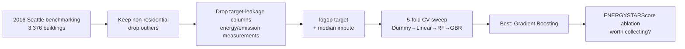
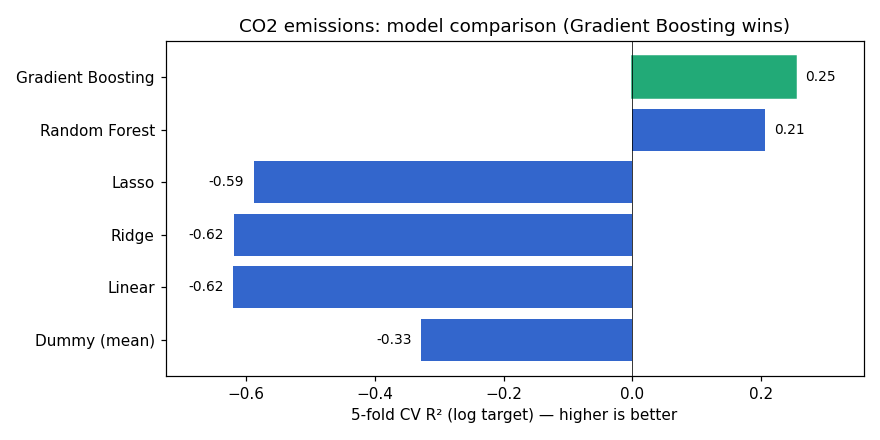
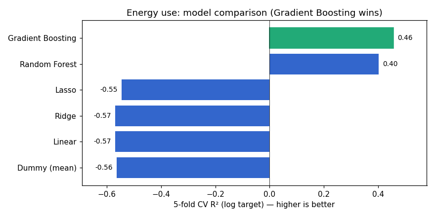
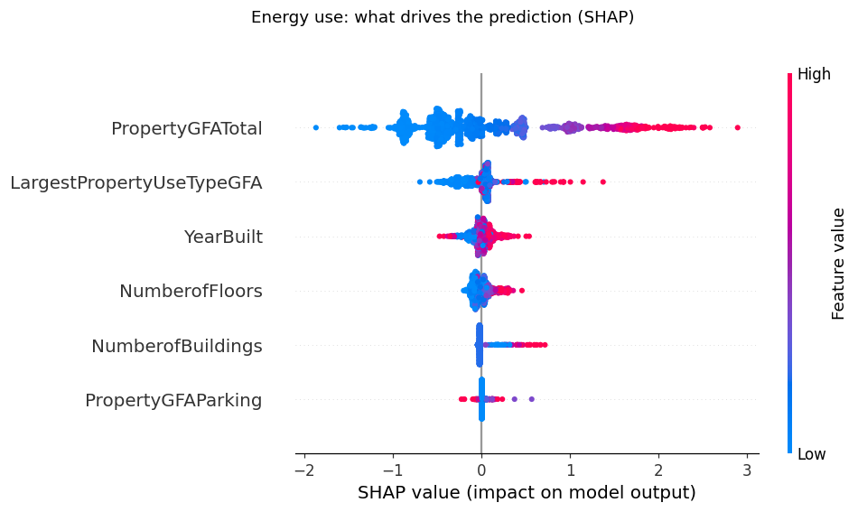
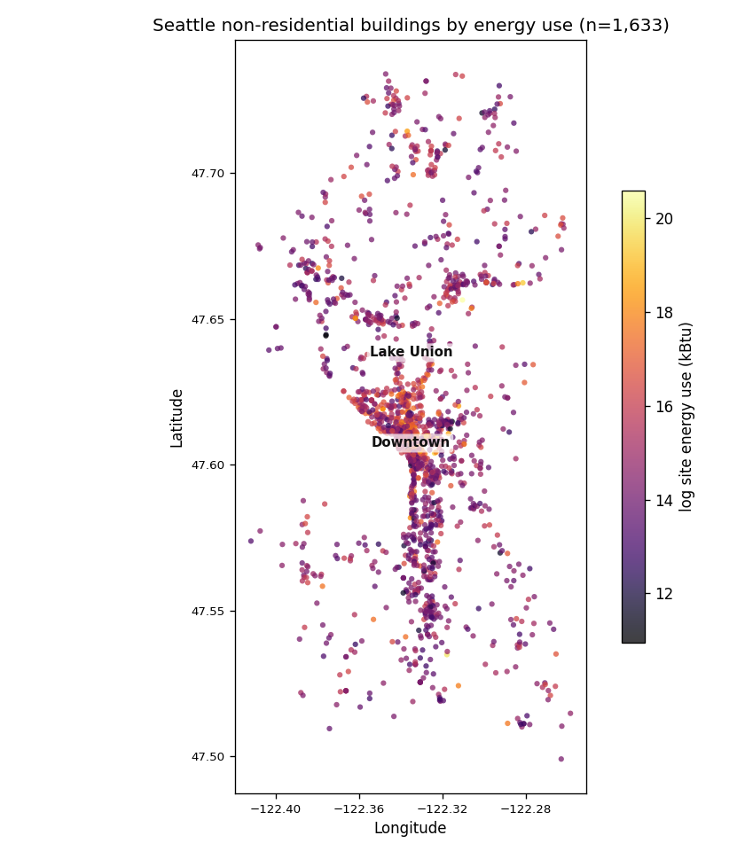

# 🏢 Predicting Building Energy Use & CO₂ Emissions — Seattle Benchmarking

[](https://github.com/boumbo85/p4-energy-prediction/actions/workflows/ci.yml)
[](https://www.python.org/)
[](https://scikit-learn.org/)


> Predicting the **energy use** and **CO₂ emissions** of Seattle's non-residential buildings from their physical characteristics (size, age, floors, use) — so the city can estimate consumption without an expensive on-site audit. Energy is predictable (**R² 0.46**); CO₂ stays harder (**R² 0.25**) for a concrete reason — emissions depend on the *energy mix* (gas vs electricity), which physical features can't see. The project answers the city's real question (**is the ENERGYSTARScore worth collecting?**), explains its predictions with **SHAP**, and puts every building back **on the map**. Built in 2022, re-run in 2026 with leakage-free features and log-transformed targets.

**Stack:** `scikit-learn` · `SHAP` · `pandas` · `Gradient Boosting` · `Random Forest` · `Ridge / Lasso` · `Python`  |  **Status:** completed  |  **Year:** 2022 · revisited 2026

> 🇫🇷 *Version française plus bas — [aller à la version FR](#-version-française).*

---

## 1. Context & Problem

Seattle tracks the energy and emissions of its large buildings, but measuring them requires costly declarations and audits. The city wants to **predict** the **total energy use** and **CO₂ emissions** of non-residential buildings from characteristics it already has on file (size, age, number of floors, use type), so new or un-audited buildings can be estimated cheaply. A secondary question drives the whole project: the **ENERGYSTARScore** is itself expensive to obtain — **does it actually improve the prediction enough to justify collecting it?**

## 2. Method & Tools

Two regression targets, `TotalGHGEmissions` (CO₂) and `SiteEnergyUse(kBtu)`, both predicted from **leakage-free** building features only. Two rigour points:

- **No target leakage.** Energy/emission columns (Electricity, NaturalGas, EUI, SteamUse) are *measurements of the target* — using them to predict energy is cheating. They're explicitly removed; only physical building features remain.
- **Log-transform the targets.** Both are extremely right-skewed (skew 14 for CO₂, 18 for energy — a few huge buildings dominate), so a `log1p` is applied before modelling.

Six models are compared with **5-fold cross-validation** (R² + RMSE): a Dummy baseline, Linear, Ridge, Lasso, Random Forest and Gradient Boosting. The ENERGYSTARScore question is answered with a direct **ablation** (best model with vs without it).

## 3. Pipeline / Schema



## 4. What Was Done

- Filtered the **2016 Seattle Building Energy Benchmarking** data to **1,651 non-residential buildings** (dropped multifamily housing and flagged outliers).
- Removed **target-leakage** features, kept physical predictors (GFA, floors, year built, buildings count, main-use GFA).
- Log-transformed both skewed targets.
- Ran a **5-fold CV model sweep** on CO₂ and on energy use, reporting R² (mean ± std) and RMSE.
- Ran an **ablation** to measure the marginal value of the ENERGYSTARScore.
- Explained the winning model with **SHAP** (which features drive the prediction).
- **Mapped** every building by energy use from its lat/lng to locate consumption.

## 5. Results

**Model comparison (5-fold CV R² on the log target):**

| Model | CO₂ — R² | CO₂ — RMSE | Energy — R² | Energy — RMSE |
|---|--:|--:|--:|--:|
| Dummy (mean) | −0.33 | 1.49 | −0.56 | 1.37 |
| Linear | −0.62 | 1.60 | −0.57 | 1.35 |
| Ridge | −0.62 | 1.60 | −0.57 | 1.35 |
| Lasso | −0.59 | 1.59 | −0.55 | 1.34 |
| Random Forest | 0.21 | 1.16 | 0.40 | 0.84 |
| **Gradient Boosting** | **0.25** | **1.12** | **0.46** | **0.80** |

*(RMSE on the log1p target; lower is better.)*




Two things jump out, and both are honest:

- **Linear models fail — worse than the mean.** Ridge/Lasso land at R² ≈ −0.6: the relationship is non-linear, and forcing a line is worse than predicting a constant. **Tree ensembles are the unlock**: Gradient Boosting reaches R² 0.25 (CO₂) and **0.46 (energy)**. The 2022 instinct to move past linear regression was right.
- **Energy is more predictable than CO₂** (0.46 vs 0.25). That makes physical sense: energy use scales with building size and age, but CO₂ depends on the *energy mix* (gas vs electricity vs steam), which the physical features don't capture.

**Is the ENERGYSTARScore worth collecting? — a measured answer:**

| Target | R² without score | R² with score | Δ |
|---|--:|--:|--:|
| CO₂ emissions | 0.253 | 0.307 | **+0.054** |
| Energy use | 0.457 | 0.530 | **+0.073** |

The score **does** help — about +5 to +7 points of R² — but it isn't decisive. So the recommendation is nuanced: collect it where the extra accuracy justifies the cost, not as a blanket requirement. That's the kind of answer the city actually needs.

**What drives the prediction — SHAP:**



A good R² isn't enough — the model has to be explainable. SHAP attributes each prediction to its features: **total floor area (`PropertyGFATotal`) dominates by far** (mean |SHAP| 0.64, ~5× the next feature), followed by the largest-use-type area, year built and number of floors. Nothing surprising — and that's the point: the model keys on size, as physics says it should, with no leakage sneaking in.

**Where are the energy-hungry buildings? — the map:**



A prediction is only useful to a city if it can be *located*. Plotting the 1,633 buildings by (log) energy use reveals a clear high-consumption corridor along **Downtown → Lake Union** — the top three neighbourhoods by median energy are **Downtown, Central and Lake Union**, Seattle's dense commercial core. This is the first step toward the climate map the project originally aimed for.

## 6. Impact

- Lets Seattle **estimate a building's energy/CO₂ without an audit** — Gradient Boosting explains **46% of the variance in energy use** from file characteristics alone.
- Turns the ENERGYSTARScore cost question into a **number** (+5–7 pts R²), so the city can decide where it's worth paying for.
- Shows the limit honestly: physical features alone don't capture the **energy mix**, which is why CO₂ stays harder to predict.

> Academic project on public data, so the impact is methodological. On client work this section would quantify audits avoided or € saved.

## 7. Interpretation

The headline isn't a single R² — it's that **the model choice is the whole game here**. A linear baseline actively misleads (negative R²); only non-linear ensembles recover real signal. And the gap between energy (0.46) and CO₂ (0.25) is informative, not disappointing: it says the missing ingredient for emissions is fuel mix, which points directly at the next feature to add.

## 8. Conclusion

A leakage-free regression that predicts Seattle building energy use at **R² 0.46** with Gradient Boosting, plus a measured verdict on the ENERGYSTARScore (+5–7 pts) — rebuilt in 2026 with the rigour (no leakage, log targets, honest baselines) the first pass lacked.

## 9. Limits & Critical Review

- **R² is modest** (0.25–0.46): physical features alone don't explain building energy well; use-type detail and climate/occupancy would help.
- **CO₂ needs the energy mix** (gas/electricity/steam shares) — deliberately excluded here as leakage-adjacent, but a cleaned version could be engineered.
- **No hyperparameter tuning** in this clean re-run (defaults + light choices); a GridSearch would lift the ensembles a few points.
- **Single year (2016)** — no temporal validation.
- **SHAP is computed on the full in-sample fit** — it explains *this* model's behaviour, not out-of-sample generalisation (the R² figures above are the cross-validated numbers).

## 10. Improvements & TODO Next

- [x] **SHAP** values to explain which features drive the prediction. *(done — size dominates)*
- [x] **Map** buildings by energy use to locate the consumption. *(done — Downtown/Lake Union corridor)*
- [ ] **Climate feature** — add Seattle Heating/Cooling Degree Days (public weather data) to test whether climate explains part of the energy/CO₂ gap. *~2h, external-data dependency.* The natural next step toward a city-climate consumption map.
- [ ] Engineer non-leaking proxies for the energy mix (e.g. heating-system type) to lift CO₂.
- [ ] GridSearch / Optuna on the Gradient Boosting and Random Forest. *~1h.*
- [ ] One-hot the building use-type categories (currently numeric features only).
- [ ] Multi-year data for temporal validation.

---

## 🗂️ Repository structure

```
p4-energy-prediction/
├── README.md
├── requirements.txt
├── requirements-dev.txt
├── pyproject.toml                # ruff + pytest config
├── LICENSE                       # MIT
├── .gitignore
├── .github/workflows/ci.yml      # lint (ruff) + tests (pytest)
├── results.json                  # all numbers in this README, reproducible
├── src/
│   ├── features.py               # pure, unit-tested cleaning + feature logic
│   └── run_models.py             # reproducible model sweep → figures + results.json
├── tests/
│   └── test_features.py          # pytest — no CSV / sklearn needed
├── notebooks/
│   ├── 01_exploration.ipynb      # EDA on the 2016 benchmarking data
│   ├── 02_model_co2.ipynb        # CO₂ emission models (2022)
│   └── 03_model_energy.ipynb     # energy-use models (2022)
├── data/
│   └── README.md                 # dataset source + license (not versioned)
└── docs/
    ├── figures/                  # model-comparison charts (regenerated)
    └── presentation.pdf          # project defense slides
```

The notebooks are the 2022 exploratory version; `src/run_models.py` is the 2026
clean, reproducible pipeline that regenerates every number and figure here.

## 📦 Data

**[2016 Building Energy Benchmarking](https://data.seattle.gov/dataset/2016-Building-Energy-Benchmarking/2bpz-gwpy)** — City of Seattle Open Data.

> **License — public domain / open data** (City of Seattle Open Data Program).
> Free to use with attribution. The CSV is included here (small, ~1 MB) for
> reproducibility; larger artefacts are not versioned. See [`data/README.md`](data/README.md).

## ▶️ Reproduce

```bash
python -m venv .venv && source .venv/bin/activate
pip install -r requirements.txt
python src/run_models.py --data data/2016_Building_Energy_Benchmarking.csv --out docs/figures --results results.json
```

## 🧪 Dev / tests

```bash
pip install -r requirements-dev.txt
ruff check .      # lint
pytest -q         # unit tests on the pure feature logic (no dataset needed)
```

---

# 🇫🇷 Version française

## 1. Contexte & Problème

Seattle suit l'énergie et les émissions de ses grands bâtiments, mais les mesurer coûte cher (déclarations, audits). La ville veut **prédire** la **consommation totale d'énergie** et les **émissions de CO₂** des bâtiments non résidentiels à partir de caractéristiques déjà connues (surface, âge, étages, type d'usage), pour estimer à bas coût les bâtiments neufs ou non audités. Une question secondaire guide tout le projet : l'**ENERGYSTARScore** est coûteux à obtenir — **améliore-t-il assez la prédiction pour justifier sa collecte ?**

## 2. Méthode & Outils

Deux cibles de régression, `TotalGHGEmissions` (CO₂) et `SiteEnergyUse(kBtu)`, prédites uniquement à partir de features **sans fuite**. Deux points de rigueur :

- **Pas de fuite de cible.** Les colonnes énergie/émissions (Electricity, NaturalGas, EUI, SteamUse) sont *des mesures de la cible* — s'en servir pour la prédire, c'est tricher. Elles sont retirées ; seules restent les caractéristiques physiques.
- **Log-transformer les cibles.** Toutes deux très asymétriques (skew 14 pour le CO₂, 18 pour l'énergie), d'où un `log1p` avant modélisation.

Six modèles comparés en **validation croisée 5-fold** (R² + RMSE) : Dummy, Linéaire, Ridge, Lasso, Random Forest, Gradient Boosting. La question de l'ENERGYSTARScore est tranchée par une **ablation** directe (meilleur modèle avec vs sans).

## 3. Pipeline / Schéma

Voir le diagramme Mermaid ci-dessus (données 2016 → non-résidentiel → retrait des fuites → log1p → balayage CV → Gradient Boosting → ablation ENERGYSTARScore).

## 4. Ce qui a été fait

- Filtrage des données **2016 Seattle Building Energy Benchmarking** à **1 651 bâtiments non résidentiels** (retrait du logement collectif et des outliers signalés).
- Suppression des features de **fuite**, conservation des prédicteurs physiques (surface, étages, année, nombre de bâtiments, surface d'usage principal).
- Log-transformation des deux cibles asymétriques.
- **Balayage de 6 modèles en CV 5-fold** sur le CO₂ et sur l'énergie (R² moy ± σ, RMSE).
- **Ablation** pour mesurer la valeur marginale de l'ENERGYSTARScore.

## 5. Résultats

**Comparaison des modèles (R² en CV 5-fold sur cible log) :**

| Modèle | CO₂ — R² | Énergie — R² |
|---|--:|--:|
| Dummy (moyenne) | −0,33 | −0,56 |
| Linéaire | −0,62 | −0,57 |
| Ridge | −0,62 | −0,57 |
| Lasso | −0,59 | −0,55 |
| Random Forest | 0,21 | 0,40 |
| **Gradient Boosting** | **0,25** | **0,46** |


Deux constats, tous deux honnêtes :

- **Les modèles linéaires échouent — pires que la moyenne.** Ridge/Lasso à R² ≈ −0,6 : la relation est non linéaire, forcer une droite fait pire que prédire une constante. **Les ensembles d'arbres débloquent** : Gradient Boosting atteint R² 0,25 (CO₂) et **0,46 (énergie)**. L'instinct de 2022 de dépasser la régression linéaire était juste.
- **L'énergie est plus prévisible que le CO₂** (0,46 vs 0,25). Logique physique : l'énergie suit la taille et l'âge, mais le CO₂ dépend du *mix énergétique* (gaz vs électricité vs vapeur), que les features physiques ne capturent pas.

**L'ENERGYSTARScore vaut-il sa collecte ? — réponse mesurée :**

| Cible | R² sans score | R² avec score | Δ |
|---|--:|--:|--:|
| Émissions CO₂ | 0,253 | 0,307 | **+0,054** |
| Consommation énergie | 0,457 | 0,530 | **+0,073** |

Le score **aide** — environ +5 à +7 points de R² — mais n'est pas décisif. Recommandation nuancée : le collecter là où le gain justifie le coût, pas comme exigence systématique. C'est le type de réponse dont la ville a besoin.

## 6. Impact

- Permet à Seattle d'**estimer l'énergie/CO₂ d'un bâtiment sans audit** — Gradient Boosting explique **46 % de la variance de la consommation** à partir des seules caractéristiques connues.
- Transforme la question du coût de l'ENERGYSTARScore en un **chiffre** (+5–7 pts R²), pour décider où il vaut la peine.
- Montre la limite honnêtement : les features physiques ne capturent pas le **mix énergétique**, d'où un CO₂ plus dur à prédire.

> Projet académique sur données publiques : impact méthodologique. Sur une mission client, cette section chiffrerait les audits évités ou les € économisés.

## 7. Interprétation

Le résultat clé n'est pas un R² unique — c'est que **le choix du modèle fait tout ici**. Une baseline linéaire induit en erreur (R² négatif) ; seuls les ensembles non linéaires récupèrent du signal. Et l'écart énergie (0,46) / CO₂ (0,25) est instructif : l'ingrédient manquant pour les émissions, c'est le mix énergétique — ce qui désigne directement la prochaine feature à ajouter.

## 8. Conclusion

Une régression sans fuite qui prédit la consommation d'énergie des bâtiments de Seattle à **R² 0,46** avec Gradient Boosting, plus un verdict mesuré sur l'ENERGYSTARScore (+5–7 pts) — reconstruit en 2026 avec la rigueur (pas de fuite, cibles log, baselines honnêtes) qui manquait au premier jet.

## 9. Limites & Regard critique

- **R² modeste** (0,25–0,46) : les features physiques seules expliquent mal l'énergie ; le détail d'usage et le climat/occupation aideraient.
- **Le CO₂ a besoin du mix énergétique** (parts gaz/électricité/vapeur) — volontairement exclu ici comme quasi-fuite, mais une version nettoyée pourrait l'ingénierer.
- **Pas de tuning d'hyperparamètres** dans ce re-run propre ; un GridSearch gagnerait quelques points.
- **Une seule année (2016)** — pas de validation temporelle.

## 10. Améliorations & TODO Next

- [ ] Ingénierer des proxys non-fuyants du mix énergétique (type de chauffage) pour le CO₂.
- [ ] GridSearch / Optuna sur Gradient Boosting et Random Forest.
- [ ] One-hot des catégories de type d'usage (actuellement features numériques seules).
- [ ] SHAP pour expliquer quelles features pilotent la prédiction.
- [ ] Données multi-années pour une validation temporelle.

---

<sub>Built under <b>AnastatsIA</b> · OpenClassrooms Data Scientist — Project 4 · standardized project format</sub>
